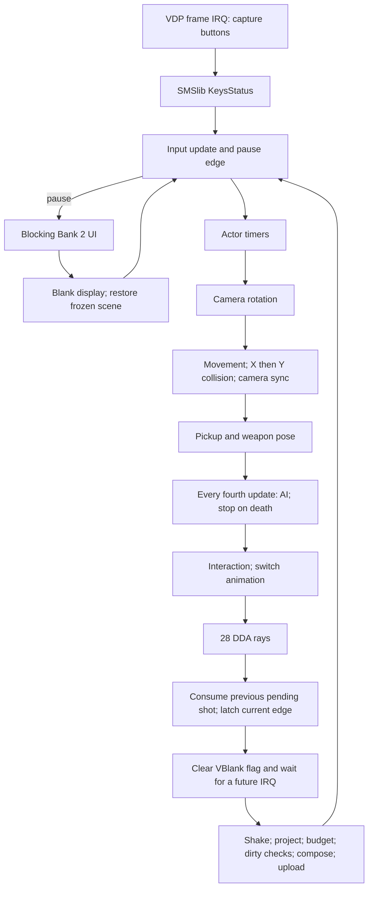

# Architecture reconstruction

## Production boundary and ownership — GR-PERF-001

The link command contains 57 local `.rel` objects. `source/main.c` is legacy, not the entry point. `game/main.c` supplies main. Asset generators run on the host; PNG decoding, palette conversion, pause-icon packing and sprite downsampling are absent from runtime. Production object membership, per-area sizes, every emitted function, direct/tail-call edges and helper sites are in [modules.csv](evidence/modules.csv), [function-source-locations.csv](evidence/function-source-locations.csv), [calls.csv](evidence/calls.csv), and [helpers.csv](evidence/helpers.csv). Those tables supplement the diagrams below; they are the function-level call graph, including private functions and conditional paths.

| Owner | Inputs → outputs | Persistent authority | Placement/frequency |
|---|---|---|---|
| main | semantic input and death status → ordered subsystem calls | pending shot; AI divider | Fixed 0, one pass per completed gameplay iteration |
| input | IRQ-captured SMSlib mask → held intents, release interaction, press fire/pause | current/previous keys; blocked holds; B2 strafe-session bit | Fixed 0, gameplay and pause polls |
| player | movement intent/current basis → collision-approved Q8.8 position | position and health | Fixed 0; movement conditional, death predicate frequent |
| camera | rotation request/player position → viewing basis/origin | X/Y, direction X/Y, plane X/Y | Fixed 0; rotation conditional |
| world/workshop | byte coordinates/tile ID → bounded floor, solidity, material/object | immutable 13×13 map; world has no mutable map array | Fixed 0; DDA/collision hot |
| doors/switch | interaction and animation tick → collision state/material ID | three door bytes; switch state/frame/divider | Fixed 0; switch divider every update, changes/event |
| world_sprite | spawn, damage, timer step → compact actor lifecycle | eight 9-byte records and count | Fixed 0; timer scan every gameplay update |
| zombie_ai/enemy_collision | player/actor/world state → chase/move/attack | packed actor bits, two navigation masks | Bank 1, every fourth gameplay update |
| zombie_shooting | pending shot, current camera/rays/weapon → one damage application | no static combat cache | Bank 1, accepted pending-shot event |
| corpse module | death expiry/door event → persistent corpse/dedup/relocation | mutates resident actor array | Bank 2, event only |
| raycaster | current camera/world → 28 six-byte results | result array, direction cache and frame origin | Fixed 0, all 28 every gameplay update |
| projection | current actors/camera/rays → temporary projected records, budget/order/change mask | no static projection cache; previous records belong to video | Bank 1, every draw, per entity staged rejection |
| video | rays/projected entities/HUD → native tile bytes and live VRAM | previous signatures, previous sprites, tile states, one-column staging | Fixed 0; checks each draw, composition only dirty columns |
| wall sampler | material/side/hit offset/height → palette index per row | automatic sampler state only | Fixed 0, dirty near halves |
| HUD weapon | acquisition/fire/selection → pose, overlay, completed-cache key | three animation/cache bytes | Bank 1; state update per gameplay iteration, pixels only dirty footprint |
| pause | frozen world/session → map/menu/SAT presentation | automatic locals only | Bank 2, blocking event loop |
| video initialization/restore | startup/frozen scene → cleared and reconstructed gameplay VRAM | one health-cell cache byte | Bank 1, startup/resume/damage |
| logo/Game Over | authored cold graphics → timed screen | no gameplay progression | Bank 3 through slot 1, startup/death |

## Subsystem execution graph

The IRQ can occur inside almost every box. It captures buttons and acknowledges VDP status; it does not advance simulation. There is no worker, rendering thread, audio callback, time accumulator or frame queue. Rendering and simulation share one sequential Z80 execution stream. Main does not catch up missed display periods.

## Startup, restart and cold closure

The outer infinite loop displays the SEGA logo for 180 VBlank waits; initializes gameplay VRAM, input and HUD; resets pending shot and AI divider; discovers all Z/G map markers; initializes player and camera; initializes/casts rays; builds a complete frame while display is off; draws the protected border; waits and enables display. This prevents startup progressive loading. It does not make ordinary live rendering atomic.

A lethal AI update breaks before interaction, raycasting and normal drawing. Main clears pending shot, invokes Bank 3 Game Over, clears VRAM/loads art while blanked, displays it for 180 waits, turns display off and restarts the outer initialization. Cold initialization includes intentional bulk clears and waits that must not enter normal gameplay statistics.

Pause branches immediately after input, before actor timers. On return it rebuilds gameplay video from the frozen rays/world/HUD and executes `continue`; that iteration performs no simulation step. Shot pending state, AI divider and all gameplay countdowns retain their values. Pause browsing changes only local UI state, selected weapon and presentation. See GR-PERF-022.

## Stage skipping and repeated work

Movement and rotation are already conditional. Ray-direction setup is cached on all four basis components, but the complete DDA result set is always recast, even when origin, basis and world solidity/material have not changed. Projection snapshots six camera scalars and determinant once per draw, then performs staged per-entity transforms. Budget selection and far-to-near ordering have different purposes. Dirty columns skip native generation and uploads, while still paying raycasting, projection and coverage/signature detection.

A static scene can safely reuse rays only with complete invalidation for camera position/basis, door state and animated switch material. A camera-only gate is incorrect. Projection cannot be skipped just because the camera is static: actors, life state, pose timers, ownership and occlusion may change. Previous/current coverage must clear disappearing or reindexed entities. No per-stage unconditional deletion is recommended.

## Build reconstruction

CMake uses custom SDCC commands; `CMAKE_BUILD_TYPE=Release` itself adds no generic C compiler optimization flags. Relevant flags are `-mz80`, `-DTARGET_GG`, includes, the SMSlib peephole file, and explicit code/constant segments. Link uses `--no-std-crt0`, `--data-loc 0xC000`, CRT first, SMSlib_GG and SDCC runtime, and `_BANK1=0x14000`, `_BANK2=0x28000`, `_BANK3=0x34000`. Makesms packages bank-aware IHX. Exact commands and dependencies are frozen in `baseline-build.zip/build.ninja` and `GearRay.lk`.

Profiling is a separate compilation with counters and, for several modules, `--opt-code-size`. Its timings cannot stand in for this Release baseline. Release PC-boundary instrumentation in the emulator avoids that disturbance. No application ISR/NMI callback registration or production profiler state is linked in the measured Release.
