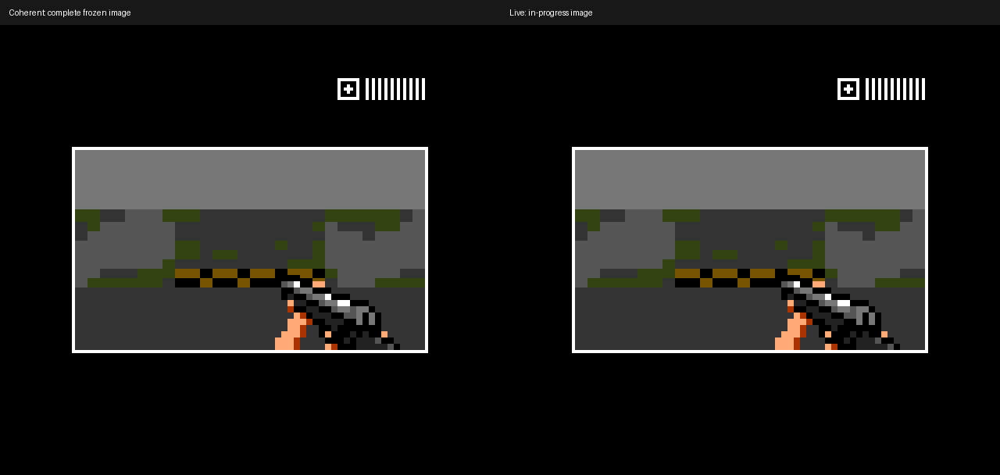

# GearRay performance implementation - 2026-10-19

## Production decision

**Retain the exact optimized synchronous engine.** Generated HUD masks, the exact camera transition graph, complete ray/material invalidation, native wall schedules, sprite spans and completed preparation reuse are enabled in the working production source. The selected ROM is [`GearRay-verified-20261019.gg`](../../../../rom/GearRay-verified-20261019.gg); `GearRay-implementation-production.gg` has the same bytes. Production retains the established update order, per-completed-loop timebase, movement/turn steps, weapon timers, AI cadence, artwork, palette, live VRAM presentation and hardware contract.

This is a substantial measured reduction in work. It does **not** solve all responsiveness and pacing limits. Changing-view rendering still spans multiple display periods and physical pulses can still fall between production polls. The 27.94-ms UP pulse in the retained absolute-time fixture is now observed once by the optimized ROM, whereas the preserved baseline misses it; that single result is not a universal pulse guarantee.

Cooperative live and coherent frozen rendering were implemented and measured separately. Their ordered input and simulation ownership work in the tested cases, but their visual age, skipped presentation episodes and changed gameplay rates do not justify promotion. Divisors 4 and 6 also fail measured deadline admission. No fixed cadence or minimum-visible-pose policy is enabled. There is consequently no proposed major gameplay-contract change awaiting approval and no artificial approval gate on the exact improvements. A future promotion requires a new measured A/B and the specific approval required by Step 4 of the master prompt.

At the original implementation handoff, no commit or push had been made. The originally dirty tree and original artwork were preserved. Subsequent Git packaging and fresh build checks are recorded in [GIT_VERIFICATION.md](GIT_VERIFICATION.md). Hardware/ASIC/flash-cartridge/LCD tests are unavailable and remain pending.

## Identities and reproducibility

| Artifact | SHA-256 | Bytes |
| --- | --- | ---: |
| Reproduced authorized baseline | `6322EFCC0434AD8D4FC3F066CED47E0A1FB4CDB140D6DA8654521E3834371136` | 65,536 |
| Selected exact production / fresh verification build | `E0FCFDD6FAE28794FED9B56CD256D27FCD029248A9A8DA846C12BB05DBF05566` | 65,536 |
| Separate profile build | `7390ACCF0EFFBAD0FBA006128F71D71CB9F3C04044BB03BB5C0C5FEB65B4534F` | 65,536 |
| Final coherent divisor-12 experiment | `78B9B1BE46160EA2634178B073016DC55298839AF245E36AC4DF64EFE5F8C131` | 65,536 |
| Final live divisor-12 experiment | `4AE2B783E53BCA5F6CEA5A084F71046B847C7B31E2926955BFB7BA1DB43239B8` | 65,536 |

Baseline input reproduction matched all 262 frozen manifest entries. `authorized-inputs.zip` preserves those inputs. The final source/art/link bundle and its manifest are `evidence/implementation/production-final-source.zip` and `production-final-identity.json`. Original audit and Astra evidence remain in place. Early exploratory named prototypes were rebuilt during iteration; final architecture runs additionally archive their ROM by hash and source/generated/link bundle by ROM hash. Do not attribute a later binary's results to an earlier named checkpoint.

SDCC 4.6.0 #16555 and installed tool hashes are recorded in `evidence/toolchain.json`. Emulicious JAR SHA-256 is `DB185A1ED0AF3BDAB5EBDEB254612D02D3848BAC155DBC89333D1B04E21C371D`. The bridge is Python 3.12 / JPype 1.5.2 / existing Java 8. ECJ 3.26.0 driver compiler hash is `AC0BA5876EAF7EBB47749A0D1BE179C51F194B9DD0B875D1C09E1B530F5A2DB5`. The emulator was not modified. VDP reset timer is pinned to 228; reported time uses actual emulated Z80 T states: 59,736 T/display period and 3,579,545 T/s.

Java drivers execute the real core and reject IRQ-acceptance pseudo-entries. Root/counter events check mapped physical page as well as PC. A completed update requires retiring its first input opcode, avoiding the old long-route boundary ambiguity. Baseline driver reproduction matched all 224 historical interval/camera/VRAM records. VRAM digest compatibility retains the historical JPype integer-buffer representation; native pixel/raster comparisons explicitly use the actual 16,384 byte values.

## Long matched production results

Ten fixed 16-update repeating routes, independent of requested sample count, each use 32 warm-up plus 256 measured updates. All **2,880 records** have equal authoritative gameplay state, camera state, all168 ray bytes and final VRAM. The final replay also compares every active actor record (asset pointers normalized by symbol identity), player/health, input, doors/switch counters, weapon/HUD timers, pending shot, AI cadence/wall-following flags, pickup and shake. Warm-up/transition/outlier records remain in the CSVs. Logical input is seeded at the input entry so faster execution cannot alter the equivalence stimulus. Physical-time input is tested separately.

These are whole update **elapsed** T states, including interrupts, VBlank waits, and mode-transition work where encountered; nested inclusive stage spans must not be added. No isolated savings percentages are added together.

| Route | Baseline mean T | Accepted mean T | Reduction | Accepted worst T |
| --- | ---: | ---: | ---: | ---: |
| A_static | 537,624 | 59,736 | 88.89% | 59,767 |
| B_rotation | 5,050,335 | 1,885,580 | 62.66% | 2,150,626 |
| C_forward | 3,278,013 | 1,803,281 | 44.99% | 1,852,393 |
| F_geometry | 4,814,795 | 1,881,898 | 60.91% | 2,126,742 |
| G_zombies | 889,955 | 284,360 | 68.05% | 25,678,282 |
| I_pistol | 2,344,638 | 537,624 | 77.07% | 941,774 |
| I_shotgun | 2,882,262 | 567,492 | 80.31% | 1,041,963 |
| J_lod | 6,219,863 | 2,267,511 | 63.54% | 25,684,122 |
| L_mixed | 7,478,585 | 2,565,736 | 65.69% | 25,705,812 |
| M_authored | 776,568 | 179,208 | 76.92% | 179,235 |

Evidence: [`final-logical-long-equivalence.json`](evidence/implementation/final-logical-long-equivalence.json), `build-implementation-baseline/logical-long/`, and accepted `build-implementation-production/logical-long/` plus `logical-extra/`; final complete state replay is in both `logical-state-final/` directories and [`final-authoritative-state-equivalence.json`](evidence/implementation/final-authoritative-state-equivalence.json). The ten scenarios include empty/static, rotation, cardinal movement, geometry/doors, eight actors, both weapons, the LOD transition route, movement/turn/fire mixture and authored workshop state.

Large retained maxima around 25.7 million T include cold death/restart presentation; they are deliberately not filtered from the table. The table is not an upper bound for every possible scene. At the measured mean, B rotation improves from about 1.41 to 0.527 seconds/update; C movement from about 0.916 to 0.504 seconds/update. Empty static work reaches the display wait, while the authored route averages three display periods. There is no single original wall-clock gameplay speed to preserve.

## Accepted implementation and provenance

| Candidate | Retained implementation and evidence |
| --- | --- |
| C03 / AR-001 | 1,160 generated native HUD mask bytes from current raw artwork/metadata. Pistol remains 24x24 from 12x12/stride8, alpha14; shotgun remains 40x32 from 20x16/stride10, right104/bottom64. All poses/backgrounds/tiles match compiled baseline. Obsolete packed held HUD objects are omitted from runtime linkage. |
| C04 | Exact reachable 242-state/484-edge camera graph, 2,420 Bank 2 bytes and one RAM byte. Signed truncation/normalization follow the old calculation; no uniform-angle approximation. Compiled turns fall from 78,628-85,269 to 462-465 T. Page 2 is restored before lookup. |
| C05 / AR-006 | Complete ray key covers all six pose scalars, three door bytes and resolved switch material. Pose/door changes recast all 28 rays. Twenty-eight terminal switch flags permit exact material-only refresh. Actor-only changes reuse all rays. Initialization invalidates. Current immutable map/three-door assumptions are explicit; door count is compile-asserted. |
| C06 / C08 | Per-tile source-X/depth span and row-plane merge replace repeated per-pixel work. Preserve alpha15, 8/16/32 sources, near-ID bank ownership, clipping, strict wall ties and far-to-near order. The overlay automatic frame shrinks from 44 to 38 bytes. |
| C09 | Exact 4,096-byte packed height/source-row schedules, 1,280 source-color column bytes and 1,024 native pair bytes, plus unchanged LOD fragments. Two 51-byte plans prepare columns; rows emit native four-plane bytes. The final worker uses Bank 3's disjoint tail without expanding the ROM. |
| C07 | Completed projection/preparation cache keys six camera values, every live actor byte/count, pickup/cell state and actual 28 wall depths. A hit copies the renderer-owned completed records and stable order, with no change mask. Empty cases fast-path; initialization invalidates. No AI/actor/timer work is skipped. |

The old scalar wall sampler is retained under `evidence/implementation/reference/`, excluded from production. Packed wall art is still the authoritative generator/proof input; only the 30-byte palette object is linked. Raw HUD PNG-derived data is still generated for provenance/validation. CMake dependencies cover generated headers, public layouts and source assets.

Isolated evidence explains selection: native HUD alone reduced B by 34.598%; world spans subsequently reduced G/J/L by 34.85/42.09/14.13% against the first exact checkpoint; native walls subsequently reduced B/G/shotgun/J/L by 36.27/45.64/51.93/59.00/48.26% against that same checkpoint. These are different comparisons, not additive production claims. The long combined table above is the accepted result.

## Compiled correctness and regression coverage

| Check | Executed coverage / result |
| --- | --- |
| Production regression | All **24 validators pass**, including all original 23 and new native-wall generation/placement/assembly checks; repeated in a fresh verification build. |
| HUD | **1,792** compiled old/new tile/pose/background cases, complete bytes/guards/SP, zero mismatches. Host artwork/mask proofs also pass. |
| Camera | **484** compiled directed transitions, all vectors/planes equal. |
| Wall rays | **11,616** complete 168-byte compiled outputs plus **11,616** actor-only reuse checks, zero mismatches. 242 bases x six fractional pairs x eight door masks; four switch materials distributed. |
| Material-only invalidation | **242** bases with five same-geometry material changes each, including restore; complete outputs equal and geometry bytes invariant; every candidate refresh below 30,000 T. |
| Sprite spans | **48,384** compiled old/new cases, 3,335 changed/nontrivial cases, zero mismatches; 8/16/32/near-ID, palette/alpha, signed clipping, wall below/equal/above, guards and callee cleanup. |
| Native wall rows | **168,960** compiled final-bank cases, zero mismatches; near heights and LOD boundaries, ten materials, sides, eight used offset bit classes, all rows, mixed halves/clipped tops/phases. Host proof covers **41,943,040** row cases/all 256 offsets plus 256 native color pairs. |
| Preparation cache | **226** actual pure/cached cases, all live actor bytes and every wall depth independently mutated, pose/count/pickup/reset/order/change-mask and executed-kernel hit/miss probes; zero mismatches. Invisible irrelevant fields normalized. |
| Arithmetic / mutation | **67,174,400** exact hit-offset and **1,323** movement cases, zero failures; five-case production-dispatch mutation test passes. |
| Long outputs | **2,880** logical records, zero authoritative-state/camera/ray/VRAM mismatch, fixed route/warm-up and all outliers retained. |
| Experimental DDA | **11,616** complete frozen-kernel cases; separate **5,808** current-combat view checks over 242 bases/eight door masks, fresh partial casts, complete-current reuse, repeated weapons and poisoned stale render snapshots, zero mismatch. |
| Experimental combat | **1,630** actual target-selection and resulting life/health/timer comparisons: both weapons, near33, 455/585/963/1260/2048 boundaries +/-1, lateral gaps, exact existing shotgun lines, wall ties, mixed occlusion, equal-depth first index, order and ineligible state. |
| Pause/restart | Existing host pause freeze includes six 3,600-VBlank modes, 36,000-VBlank next-step equivalence and 100 cycles. Prototype also completes **103 actual CPU pause/resume cycles** with all tracked gameplay bytes equal; actual lethal AI then Game Over/logo/restart restores health100/pistol and blocks held fire. |

Files `final-*-oracle.json`, `final-camera-edge-replay.json`, `final-ray-equivalence.json`, `final-material-ray-equivalence.json`, `projection-cache-oracle.json`, `combat-compiled-oracle.json`, `current-combat-sample-equivalence.json` and their `.py`/Java sources live in `evidence/implementation/`. Normal build validators retain pickup/duplicate/manual selection, pending-shot order/current selection, eight living/offscreen actors, corpses/compaction/crush, door safety, strict occlusion, LOD/budget/order, startup/health/border/Game Over contracts.

## Cooperative architecture experiments

Source is isolated in `build-implementation-architecture-source/`; final and intermediate measured source/generated/link bundles are archived in `evidence/implementation/architecture-<ROM hash>.zip`. No scheduler/render-job source enters the selected production link.

The prototype implements a resident 64-entry `{sequence16,mask8}` SPSC ring, 16 ordered actions, high-bit START normalization, edge-only B1, full B2 sessions, one-use short directional taps/opposing cancellation, input epochs and sticky overflow admission failure. Two overdue ticks are the maximum burst; due simulation precedes more rendering. Overflow stops simulation and rendering rather than silently dropping time/actions. Snapshots copy all actors by value and own their rays, pose/doors/material/pickup/weapon/HUD/health/shake and generation. Combat uses the current resolution-time pose and explicit 13/14 or 10/14/18 wall samples; stale displayed/job rays are never its authority.

Projection arithmetic and exact ray/wall/sprite/HUD/upload work use explicit resumable phases. One job completes before capturing latest state. Every physical buffer has independent ray/coverage/HUD validity. Cancelled jobs invalidate both buffers. Pause freezes simulation/pending/AI divider, cancels, blanks and restores; restart closes epochs and clears old actions. State remains independent of forced 2/4/16/120-refresh render holds: **342 identical logical records** for each 4,096-refresh combat run, 342 captured fire edges, 341 consumed and one legitimately pending at the observation boundary. No queue/bank/IRQ-register/latch violation is observed.

The initial `LD A,I` IFF-probe idiom encountered the emulated NMOS interrupt race and lost service. It was rejected. Final short critical helpers are explicitly main-only with interrupts enabled on entry; they do not promise a general save/restore-IFF API. Producer writes payload before its atomic head publication; occupied payloads cannot be overwritten. Main uses a high-low-high clock read. Hook max417 T normally /445 with START; observed whole SMSlib ISR max767/795 T, plus hardware/vector entry overhead. This is below the initial 1,500-T allowance. The hook owns neither VDP nor mapper nor gameplay.

The installed SMSlib has only R0/R1 shadow bytes (`VDPReg[2]`), **no R2 shadow**. The prototype therefore owns R2 and explicit name addresses; cold screens reset it while blanked before using SMSlib's hardcoded 0x3800 name writers. Its coherent layout reserves patterns102..213 and214..325, name tables0x3800/0x3000, **5,632 added VRAM bytes**. It has no CPU framebuffer. Safe stream commands remain protected; bulk copies do not mask IRQs. Measured R2 writes occur in blank scanlines200..226, with no writes to referenced front patterns/names.

### Deadline and rate admission

All rows below are actual 4,096-refresh heavy combat runs using the same eight-actor fixture and absolute two-fire-edge bursts. No offscreen AI is deleted.

| Variant | Logical ticks | Publications | Deadline misses | Max complete input + gameplay service T | Longest renderer step T |
| --- | ---: | ---: | ---: | ---: | ---: |
| Coherent divisor4 | 1,024 | 33 | 251 | 461,901 | 28,358 |
| Coherent divisor6 | 683 | 36 | 88 | 454,473 | 29,776 |
| Coherent divisor12 | 342 | 40 | 0 | 454,911 | 29,676 |
| Live divisor12 | 342 | 41 | 0 | 454,911 | 29,776 |

Divisors4/6 are rejected. Divisor12 is approximately4.994 simulation ticks/s; a period is716,832 T. An 80% service ceiling leaves573,465 T. The measured full service plus a30,000-T blocking chunk, one15,872-T snapshot, a971-T commit and12 conservative818-T IRQ services totals511,570 T, within that measured reserve. This is a tested workload admission estimate, **not an exhaustive WCET proof** of every rare event combination. AI max140,405 T, shooting max307,707 T, ray step26,326 T and projection step22,267 T in the heavy trace. Nested inclusive spans must not be added again.

Fine initial phases incurred major dispatch/setup cost and produced3-4-second ages. Coarser phases improve throughput, but the original6,000-T chunk target is **not met**; the observed bound is declared and included in the deadline estimate. A future tighter cadence needs another iteration. Stable simulation alone is insufficient for production selection.

The deliberate timebase A/B is substantial: divisor12 keeps each74/256-cell move and ~7.6-8-degree turn but applies them at~4.994 ticks/s. Cardinal speed would be~1.44 cells/s; AI would advance once per4 ticks (~1.248 AI passes/s). The selected synchronous C route averages~1.99 updates/s while the authored M route averages~19.97. A fixed rate would speed some states and slow others. It cannot be called an exact behavior-preserving change.

### Input, scanout and presentation age

Actual half/one/two/four-refresh B1 pulses were swept over four phases. All12 pulses of at least one refresh, two observed half-refresh pulses and the extra two edges within one tick were captured/consumed exactly once (**16** total); two half-refresh pulses between hardware samples are unobserved, as expected. Twenty-one compiled ring/action cases additionally cover full/empty/no-overwrite/overflow, head/tail wrap, 16-bit sequence wrap, cutoff, held autofire rejection, repeated ordering, B2 release ordering and epochs.

In the heavy burst run, sampled fire edge to the tick's completed pending-shot latch is8.39-23.65 refreshes (median15.82). This includes the real tick's work and repeated-action queueing. Pending damage resolution remains the following logical tick, using its current weapon/camera/actors; these figures are not physical button-to-photon measurements.

| Scanout measurement, 4,096-refresh combat | Coherent d12 | Live d12 |
| --- | ---: | ---: |
| Completed publications | 40 | 41 |
| Post-first-publication frames matching latest completed image | 4,012 | 1,290 |
| Intermediate/incomplete raster frames | 0 | 2,758 |
| Mixed name-table-base LCD frames | 0 | 0 |
| Snapshot to complete LCD, min / median / max refreshes | 72.67 / 98.69 /132.73 | 48.45 /89.68 /132.69 |
| Snapshot to first changed complete LCD, min / median / max | 72.67 /99.69 /132.73 | 17.67 /22.73 /55.73 |

The first-changed measure conservatively uses a whole LCD scan starting after capture, compared with the front image at capture; it does not mistake the previous job's just-published frame for the new job's response. The emulator's actual scanline output is copied after its renderer, rather than reconstructing a raster from final VRAM alone. All40 coherent combat and70 turning publications also match23,040 native LCD palette indices rendered by the compiled synchronous reference, including both physical buffers, border and health.

Coherent complete visibility costs approximately1.21-2.22 seconds from capture in this workload; live partial response improves but can still leave mixed content. Sampling coalesces state: a separate sparse-fire run records18 authoritative firing episodes but9 visible firing episodes. Damage/timers were not delayed to hide that loss. No presentation-only minimum-visible latch is promoted; evaluating and approving such a policy would be required before changing visible-pose behavior.



The screenshot is an illustrative pair of actual scanout samples, not same-generation pixel-equivalence evidence. The machine-checked raster/latency results are in [`architecture-analysis.json`](evidence/implementation/architecture-analysis.json); per-frame hashes/native buffers and port timing are retained in each trace directory.

## Resources, ABI and banking

| Resource | Authorized baseline | Selected exact production | Final d12 experiment |
| --- | ---: | ---: | ---: |
| Packaged ROM |65,536|65,536|65,536|
| Bank0 extent |15,629|12,961|12,527|
| Bank1 extent |13,516|14,217|13,641|
| Bank2 extent |9,317|11,737|15,406|
| Bank3 physical extent |4,605|12,756|13,268|
| Static RAM |1,239|1,538|2,255|
| Observed gameplay stack |baseline traces retained|383|157 (142 restart /134 pause)|
| Added VRAM |0|0|5,632 coherent reservation|
| Application helper sites |48|37|separate experimental link|
| Cold banked dispatch sites |8|8|separate experimental link|

Bank0 includes fixed sections/CRT accounting; Bank1 reserves the16-byte header. Bank3's production physical extent includes its3-byte gap; actual cold length is0x11FD and native tail0x1FD4 at physicaloffset0x1200. Root link address is`_BANK3WALL=0x39200`; experimental cold growth requires its tail at0x39400. Page3 can execute in slot1 for cold screens and slot2 for walls only because these physical ranges do not overlap. Both versions are payload/header/extent checked and return to slot1=1/slot2=2 at public/yield boundaries.

Selected persistent data ends at0xC602; a1,024-byte stack reserve below initialSP0xDFF0 begins0xDBF0, leaving5,614 bytes between persistent data and that reserve. Conservative generated-call analysis bounds the selected main closure at588 bytes before explicit IRQ allowance; even adding32 bytes remains below the reserve. Observed long-route stack maximum is383 bytes. Unknown library leaf allowances are conservative, not proof of every possible hardware NMI timing. No new selected-production assembly changes the ABI; compiled pointer/byte-argument/guard/callee-cleanup tests inspect the emitted calling model. Prototype critical assembly documents A return/clobber/main-only IRQ context.

Original resource category ceilings were planning estimates, refined by linked totals: the completed preparation key is about158 bytes rather than128, and experimental per-buffer metadata/snapshot/continuation allocation exceeds some early category targets. Actual RAM,1-KiB stack reserve and no-full-framebuffer constraints remain satisfied. Fresh link maps and per-module/RAM CSVs give the authoritative allocation.

## Rejected, refined and deferred work

- C01/C02: capture/fixed scheduler implemented and tested, isolated; production promotion rejected for present visual age/feel and incomplete global rare-event admission proof.
- C10/C11: coherent/full rebuild, per-physical-buffer reuse and live output compared. Full rebuild's3-4-second age is rejected; improved cache/grouping still does not beat selected behavior overall. No shared front-referenced pattern dictionary or full CPU framebuffer is promoted.
- C12: exact height LUT/threshold alternatives remain optional. Native schedule/compositor work addressed measured costs first; no unmeasured LUT speed claim is made.
- C13: no speculative general assembly rewrite. Exact compiled kernel/ownership changes and measured native row plans are used; unsafe copy and NMOS IFF probe are rejected.
- C14: legacy wall loop compression/canonical signatures deferred after compositor ownership changed; no unsupported gain claimed.
- C15: reproduced saturating16-bit DDA is slower by3,301 T on static rays and adds203 resident bytes; rejected.
- C16/C17: wait removal as a complete fix, assumed60-Hz gameplay, unsafe transfer, cold-bank reshuffle as hot-call savings and removing offscreen AI/corpses are rejected.
- C18: uniform camera angles, altered movement/aim, reduced art/view and reprojection are not silently adopted.
- Some validators initially rejected valid new symbol/area layouts. They now recognize the cached coordinator and the explicit Bank3 wall tail while retaining runtime/payload/bank assertions. A measurement-only phase-variable shadowing bug in the pulse driver was corrected before final evidence. These were not hidden gameplay exceptions.

## Build, rerun and source changes

```powershell
cmake -S . -B build-implementation-release-final -G Ninja '-DCMAKE_BUILD_TYPE=Release' '-DGEARRAY_PROFILE_RENDERER=OFF' '-DGEAR_RAY_ROM_FILENAME=GearRay-verified-20261019.gg'
cmake --build build-implementation-release-final
powershell -NoProfile -ExecutionPolicy Bypass -File tools/full_z80_audit.ps1 -BuildDirectory build-implementation-release-final -RunValidators
py -3.12 docs/performance/2026-10-19/evidence/implementation/emulicious_bench.py 256 --warmup 32 --logical-input --build build-implementation-production --rom rom/GearRay-implementation-production.gg --only A_static,B_rotation,C_forward,F_geometry,G_zombies,I_pistol,I_shotgun,J_lod,L_mixed,M_authored --output build-implementation-production/replay-rerun
```

Set the Python bridge directory in`PYTHONPATH` for standalone oracle scripts. `architecture_bench.py --build build-implementation-coherent64-12 --periods 4096 --mode combat`. The exact commands and output roots are retained in build logs. Architecture output automatically archives source/ROM identity; run `analyze_architecture.py` after retaining all referenced trace modes. Extend timeouts for long baseline runs; do not change route reversal with sample count. PowerShell child `PSModulePath` may need the standard Windows PowerShell Modules directory for `Get-FileHash`.

Production runtime changes: `game/camera.c`, `engine/render/raycaster.c`, `platform/game_gear/hud_weapon.c`, `video.c`, `video_initialization.c`, `sprite_projection.c/.h`, new `native_wall.c/.h`, removal of production `render_textures.c/.h`, and `CMakeLists.txt`. Generators: new camera graph, HUD mask and native wall scripts; palette-only output added to the wall generator. Validators/audits updated for actual ROM identity, payload mapping, native layouts and cache coordination. Maintained docs updated: README, CURRENT_BEHAVIOR, ENGINE_ARCHITECTURE, BUILDING, ROM_BANKING and Developer Bible. `production-final-identity.json` lists exact changes relative to the frozen authorized input ZIP, avoiding attribution of pre-existing dirty edits to this implementation.

## Remaining manual gates and limits

1. In Emulicious's interactive debugger, run the delivered exact ROM through long movement/turn/fire, pickup/manual weapon selection, pause MAP/WEAPONS, maximum corpses/door crush, Game Over and restart; inspect scanout and subjective control feel. Automated headless-core checks above are completed; subjective desktop review is not represented as physical testing.
2. On available original Game Gear/ASIC variants, flash cartridge/mapper and actual LCD, verify cold Bank3 screens and slot2 native walls, VDP copy cadence/control atomicity, health/border/scroll, audio/input and first visible frame. Record hardware identity and behavior; no pass is invented.
3. Keep cooperative variants experimental until visible-age/pose policy and all rare tick combinations meet a declared admission target. A changed fixed cadence/aim/presentation policy needs a concrete approved A/B before integration. Current measured success does not establish60-Hz simulation or physical button-to-photon latency.

The exact optimizations and completed negative architecture decision are delivered. Render-dependent timing, intermediate live presentation and unsampled physical pulses remain explicit production limitations, not solved-responsiveness claims.
